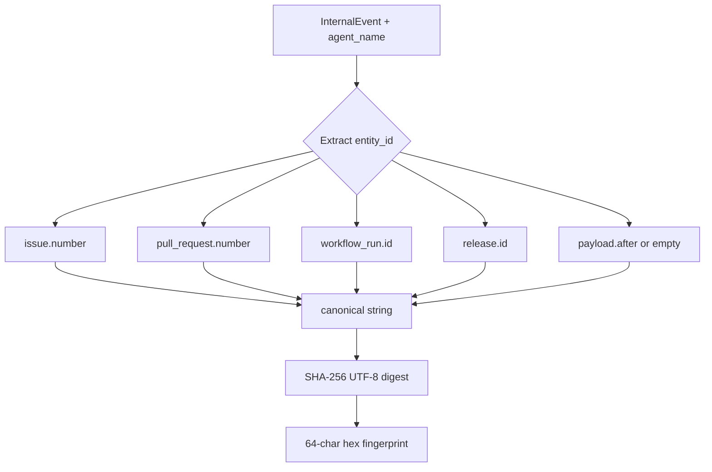
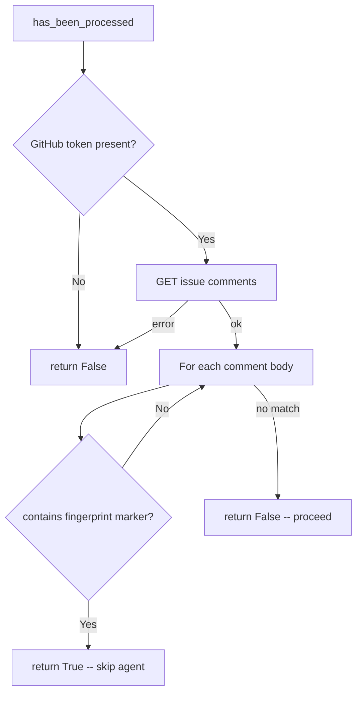
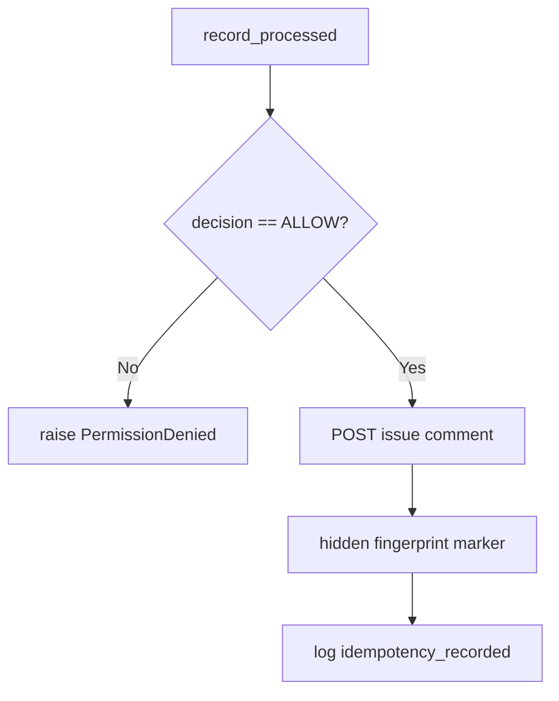
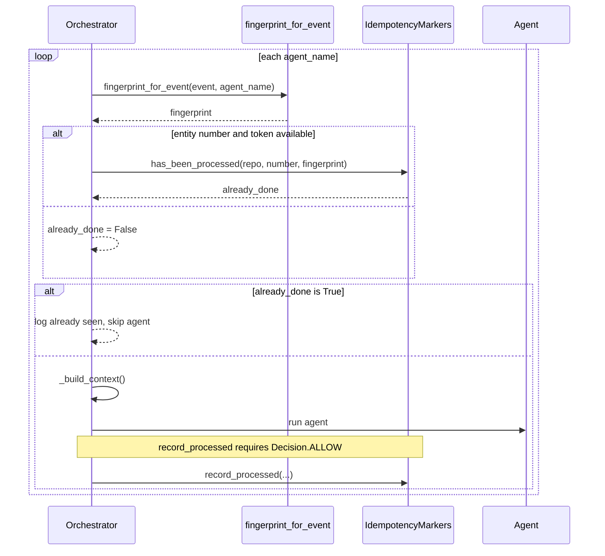

# Idempotency -- Fingerprint and Marker Flow

This document describes `repoheart/idempotency/`: how RepoHeart derives a deterministic fingerprint for an event+agent pair, how it looks for that fingerprint in issue/PR comments, and how a marker is written after a successful run.

Idempotency is a core correctness guarantee. Re-running the workflow on the same GitHub event must always be a no-op for an agent that has already recorded a marker. A different event name, action, repository, entity, or agent name produces a different fingerprint, so skipping is never incorrect for a first-time combination.

## Part 1 -- Fingerprint generation

`fingerprint_for_event()` in `repoheart/idempotency/fingerprint.py` extracts an entity id from the payload, then `compute_fingerprint()` hashes a canonical string with SHA-256. The result is a 64-character lowercase hex digest.

Entity id resolution order: issue number, pull request number, workflow_run id, release id, payload after (push head SHA), then empty string.

When `agent_name` is empty the fingerprint is event-level (pre-routing). When it is set (as the Orchestrator does per agent), the fingerprint is per-agent, so two agents can independently process the same issue event.

The canonical form is `{event_name}.{action}:{repo_full_name}:{entity_id}:{agent_name}`.

## Part 2 -- Marker read (`has_been_processed`)

`IdempotencyMarkers.has_been_processed(repo, issue_or_pr_number, fingerprint)` lists comments on the issue or PR and looks for a hidden HTML comment of the form `<!-- repoheart:fingerprint:{64-hex} -->`.

If the GitHub token is missing, or the comments request fails, the method returns False (conservative: treat as not yet processed so work is not silently dropped).

## Part 3 -- Marker write (`record_processed`)

`IdempotencyMarkers.record_processed(...)` posts the hidden comment. The write goes through `GitHubClient.post_comment(..., decision)` and therefore requires `Decision.ALLOW`. Any other decision raises `PermissionDenied` -- the same Safety Gate rule as other writes.

## Part 4 -- Orchestrator loop

Inside the per-agent loop the Orchestrator fingerprints the current event for that agent, checks markers when an entity number and token are available, and skips the agent when a marker is already present.

## Why re-running is always safe

The fingerprint includes event name, action, repository, entity, and agent. A replay of the same webhook therefore hashes to the same digest. Once that digest is stored as a comment marker, `has_been_processed` returns true and the Orchestrator does not run the agent again. A different issue, action, or agent cannot collide with that marker because the canonical string -- and therefore the SHA-256 digest -- would differ.
